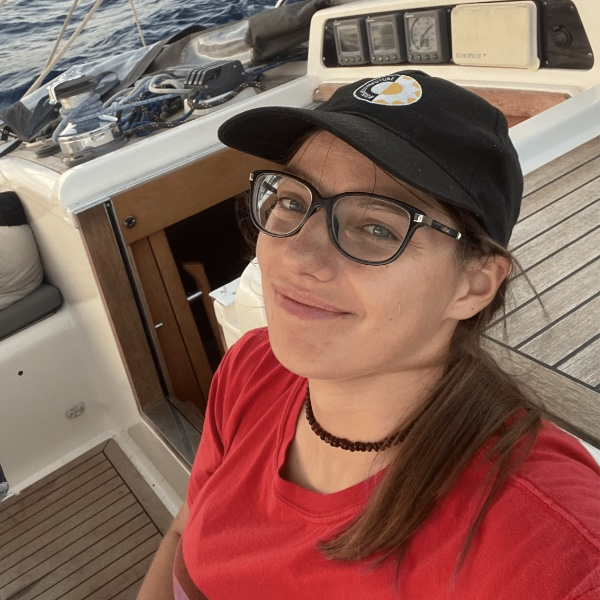
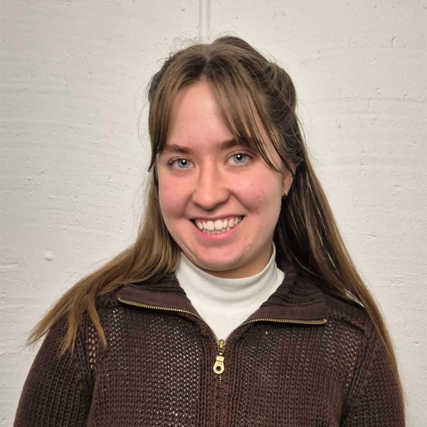
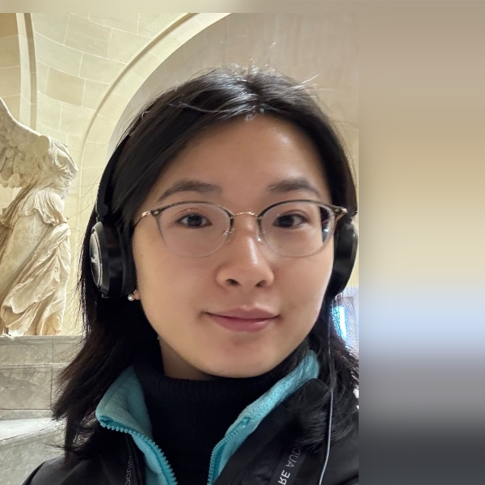
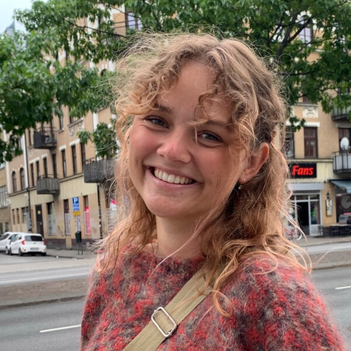
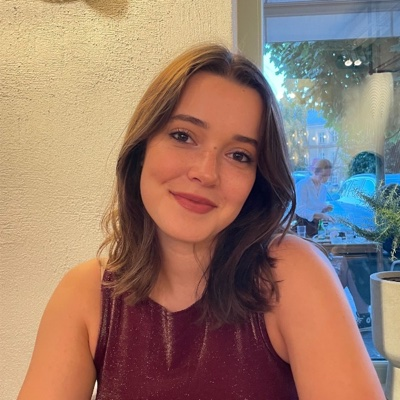
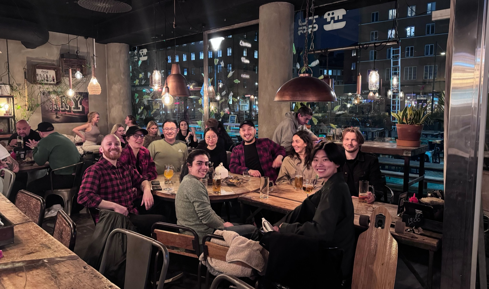
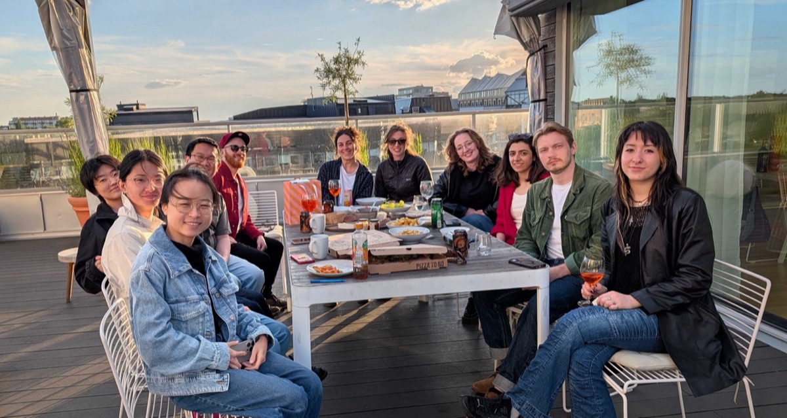
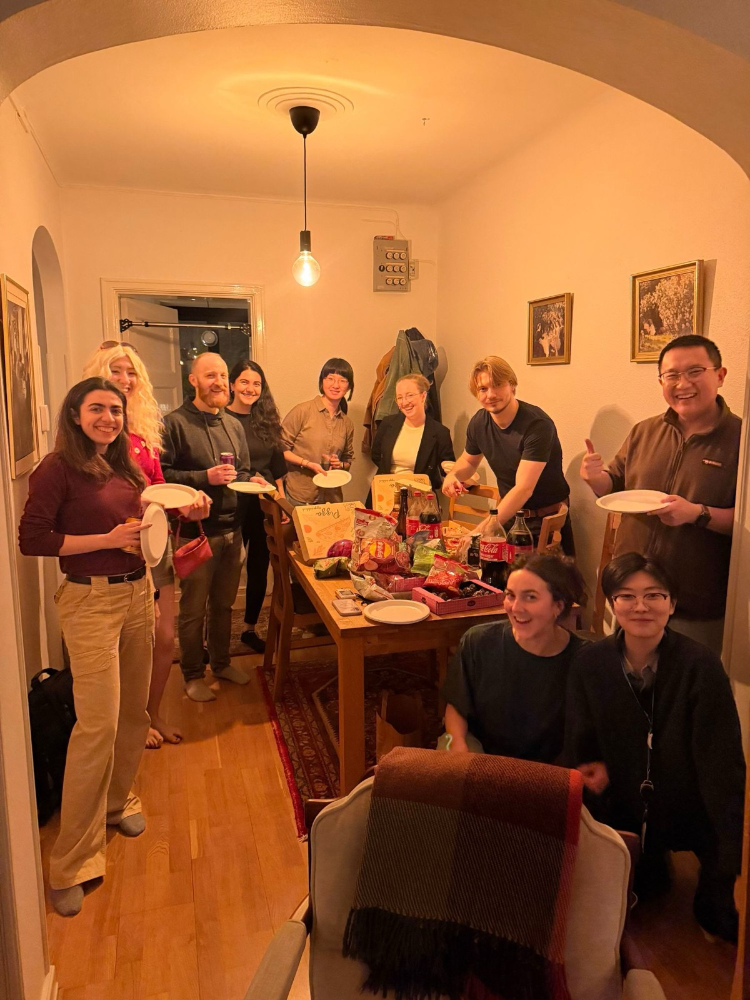

<!--
Each person is one "member-card". To add LinkedIn or Google Scholar, put these
inside that person's member-links div:
  <a href="LINKEDIN_URL" title="LinkedIn"><i class="bi bi-linkedin"></i></a>
  <a href="SCHOLAR_URL" title="Google Scholar"><i class="bi bi-mortarboard-fill"></i></a>
-->

<div class="members-page">

## Principal Investigator

```{=html}
<div class="member-grid pi-grid">
<div class="member-card">
<a href="members/jake.html"></a>
<a class="member-name" href="members/jake.html">Jacob Vogel</a>
<div class="member-major">PhD in Neuroscience</div>
<div class="member-role">Principal Investigator</div>
<div class="member-links">
<a href="https://www.linkedin.com/in/jacob-vogel-a75a6a48/" title="LinkedIn"><i class="bi bi-linkedin"></i></a>
<a href="https://scholar.google.com/citations?user=1m6yqlwAAAAJ" title="Google Scholar"><i class="bi bi-mortarboard-fill"></i></a>
<a href="https://x.com/_JakeVogel_" title="X"><i class="bi bi-twitter-x"></i></a>
<a href="https://github.com/illdopejake" title="GitHub"><i class="bi bi-github"></i></a>
</div>
</div>
</div>
```

## Researchers

```{=html}
<div class="member-grid">
<div class="member-card">
<a href="members/hannah.html"></a>
<a class="member-name" href="members/hannah.html">Hannah Baumeister</a>
<div class="member-major">PhD in Clinical Neuroscience</div>
<div class="member-role">Postdoctoral researcher</div>
<div class="member-links">
<a href="https://www.linkedin.com/in/hannah-baumeister-815199137/" title="LinkedIn"><i class="bi bi-linkedin"></i></a>
<a href="https://scholar.google.com/citations?user=fqU2UX0AAAAJ" title="Google Scholar"><i class="bi bi-mortarboard-fill"></i></a>
<a href="https://github.com/hannahbaumeister" title="GitHub"><i class="bi bi-github"></i></a>
</div>
</div>
<div class="member-card">
<a href="members/lijun.html"></a>
<a class="member-name" href="members/lijun.html">Lijun An</a>
<div class="member-major">PhD in Electrical and Computer Engineering</div>
<div class="member-role">Postdoctoral researcher</div>
<div class="member-links">
<a href="https://www.linkedin.com/in/anlijuncn/" title="LinkedIn"><i class="bi bi-linkedin"></i></a>
<a href="https://scholar.google.com/citations?user=La_luGsAAAAJ" title="Google Scholar"><i class="bi bi-mortarboard-fill"></i></a>
<a href="https://x.com/anlijuncn" title="X"><i class="bi bi-twitter-x"></i></a>
<a href="https://anlijun.cn" title="Homepage"><i class="bi bi-globe"></i></a>
<a href="https://github.com/anlijuncn" title="GitHub"><i class="bi bi-github"></i></a>
</div>
</div>
<div class="member-card">
<a href="members/lea.html"></a>
<a class="member-name" href="members/lea.html">Léa Chauveau</a>
<div class="member-major">PhD in the Neuropresage</div>
<div class="member-role">Postdoctoral researcher</div>
<div class="member-links">
<a href="https://www.linkedin.com/in/léa-chauveau-7159283a3/" title="LinkedIn"><i class="bi bi-linkedin"></i></a>
<a href="https://scholar.google.com/citations?user=r-iD8O0AAAAJ" title="Google Scholar"><i class="bi bi-mortarboard-fill"></i></a>
<a href="https://github.com/leaach" title="GitHub"><i class="bi bi-github"></i></a>
</div>
</div>
<div class="member-card">

<span class="member-name">Rosa Aghdam</span>
<div class="member-major">PhD in Statistics</div>
<div class="member-role">Assistant Researcher</div>
<div class="member-links">
<a href="https://www.linkedin.com/in/rosa-aghdam/" title="LinkedIn"><i class="bi bi-linkedin"></i></a>
<a href="https://scholar.google.com/citations?user=y6uIjXEAAAAJ" title="Google Scholar"><i class="bi bi-mortarboard-fill"></i></a>
<a href="https://github.com/rosaaghdam" title="GitHub"><i class="bi bi-github"></i></a>
</div>
</div>
<div class="member-card">

<span class="member-name">Sophie Mastenbroek</span>
<div class="member-major">PhD in Radiology and Nuclear Medicine</div>
<div class="member-role">Assistant Researcher</div>
<div class="member-links">
<a href="https://www.linkedin.com/in/sophie-mastenbroek-472553199/" title="LinkedIn"><i class="bi bi-linkedin"></i></a>
<a href="https://scholar.google.com/citations?user=T4HzFjYAAAAJ" title="Google Scholar"><i class="bi bi-mortarboard-fill"></i></a></div>
</div>
<div class="member-card">
<a href="members/xiaoyu.html"></a>
<a class="member-name" href="members/xiaoyu.html">Yu Xiao</a>
<div class="member-major">PhD in Neuroscience and Behavioral Disorders</div>
<div class="member-role">Postdoctoral researcher</div>
<div class="member-links">
<a href="https://www.linkedin.com/in/yu-xiao-34006a170/" title="LinkedIn"><i class="bi bi-linkedin"></i></a>
<a href="https://scholar.google.com/citations?user=0b5LOrYAAAAJ" title="Google Scholar"><i class="bi bi-mortarboard-fill"></i></a>
<a href="https://github.com/xiaoyucaly" title="GitHub"><i class="bi bi-github"></i></a>
</div>
</div>
</div>
```

## PhD Students

```{=html}
<div class="member-grid">
<div class="member-card">
<a href="members/gabri.html"></a>
<a class="member-name" href="members/gabri.html">Gabriele Vilkaite</a>
<div class="member-major">Molecular Cell Biology</div>
<div class="member-role">PhD Student</div>
<div class="member-links">
<a href="https://github.com/Gabi86" title="GitHub"><i class="bi bi-github"></i></a>
</div>
</div>
<div class="member-card">
<a href="members/jon.html"></a>
<a class="member-name" href="members/jon.html">Jonathan Rittmo</a>
<div class="member-major">Statistics</div>
<div class="member-role">PhD Student</div>
<div class="member-links">
<a href="https://www.linkedin.com/in/jrittmo/" title="LinkedIn"><i class="bi bi-linkedin"></i></a>
<a href="https://scholar.google.com/citations?user=KbE1v_4AAAAJ" title="Google Scholar"><i class="bi bi-mortarboard-fill"></i></a>
<a href="https://twitter.com/jorittmo" title="X"><i class="bi bi-twitter-x"></i></a>
<a href="https://github.com/jorittmo" title="GitHub"><i class="bi bi-github"></i></a>
</div>
</div>
<div class="member-card">
<a href="members/mirjam.html"></a>
<a class="member-name" href="members/mirjam.html">Mirjam Müller</a>
<div class="member-major">Mathematics and Bioinformatics</div>
<div class="member-role">PhD Student</div>
<div class="member-links">
<a href="https://www.linkedin.com/in/mirjamcmmüller/" title="LinkedIn"><i class="bi bi-linkedin"></i></a>
<a href="https://github.com/mirjamcmmueller" title="GitHub"><i class="bi bi-github"></i></a>
</div>
</div>
<div class="member-card">
<a href="members/narjes.html"></a>
<a class="member-name" href="members/narjes.html">Narjes Goshtasbi</a>
<div class="member-major">Biomedical Engineering</div>
<div class="member-role">PhD Student</div>
<div class="member-links">
<a href="https://www.linkedin.com/in/narjes-goshtasbi-505315199/" title="LinkedIn"><i class="bi bi-linkedin"></i></a>
<a href="https://scholar.google.com/citations?user=3b_DJpsAAAAJ&amp;hl=en" title="Google Scholar"><i class="bi bi-mortarboard-fill"></i></a>
<a href="https://github.com/narjesgoshtasbi" title="GitHub"><i class="bi bi-github"></i></a>
</div>
</div>
</div>
```

## Research Assistants

```{=html}
<div class="member-grid">
<div class="member-card">
<a href="members/romina.html"></a>
<a class="member-name" href="members/romina.html">Romina Zendehdel</a>
<div class="member-major">Molecular Medicine</div>
<div class="member-role">Research Assistant</div>
<div class="member-links">
<a href="https://www.linkedin.com/in/rominazendehdel/" title="LinkedIn"><i class="bi bi-linkedin"></i></a>
<a href="https://github.com/Romina-Ze" title="GitHub"><i class="bi bi-github"></i></a>
</div>
</div>
<div class="member-card">
<a href="members/ruoyi.html"></a>
<a class="member-name" href="members/ruoyi.html">Zoe Ruoyi Zhao</a>
<div class="member-major">Machine Learning</div>
<div class="member-role">Research Assistant</div>
<div class="member-links">
<a href="https://www.linkedin.com/in/zoe-ruoyi-zhao-3592b6226/" title="LinkedIn"><i class="bi bi-linkedin"></i></a>
<a href="https://github.com/Zoe-Chao" title="GitHub"><i class="bi bi-github"></i></a>
</div>
</div>
</div>
```

## Students

```{=html}
<div class="member-grid">
<div class="member-card">

<span class="member-name">Elsa Gustafsson</span>
<div class="member-major">Biomedical Engineering</div>
<div class="member-role">Master Project</div>
<div class="member-links"></div>
</div>
<div class="member-card">

<span class="member-name">Nadine Li Pigida</span>
<div class="member-major">Bioinformatics</div>
<div class="member-role">Master Project</div>
<div class="member-links"></div>
</div>
<div class="member-card">

<span class="member-name">Yaqi Jiao</span>
<div class="member-major">Bioinformatics</div>
<div class="member-role">Master Project</div>
<div class="member-links">
<a href="https://www.linkedin.com/in/yaqi-jiao/" title="LinkedIn"><i class="bi bi-linkedin"></i></a>
</div>
</div>
</div>
```

## Alumni

```{=html}
<div class="member-grid">
<div class="member-card">

<span class="member-name">Alma Lennartsson</span>
<div class="member-major">Biomedical Engineering</div>
<div class="member-role">Master student (2025–2026)</div>
<div class="member-links">
<a href="https://www.linkedin.com/in/alma-lennartsson-81a60424a/" title="LinkedIn"><i class="bi bi-linkedin"></i></a>
<a href="https://github.com/almalennartsson" title="GitHub"><i class="bi bi-github"></i></a>
</div>
</div>
<div class="member-card">

<span class="member-name">Catarina Barreiros</span>
<div class="member-major">Biomedicine</div>
<div class="member-role">Bachelor thesis (2024-2025)</div>
<div class="member-links">
<a href="https://www.linkedin.com/in/catarina-barreiros-a497a4221/" title="LinkedIn"><i class="bi bi-linkedin"></i></a>
<a href="https://github.com/catabr14" title="GitHub"><i class="bi bi-github"></i></a>
</div>
</div>
<div class="member-card">

<span class="member-name">Emma Volcov</span>
<div class="member-major">Biomedicine</div>
<div class="member-role">Bachelor thesis (2024-2025)</div>
<div class="member-links">
<a href="https://www.linkedin.com/in/emma-volcov-3b31b9319/" title="LinkedIn"><i class="bi bi-linkedin"></i></a>
</div>
</div>
<div class="member-card">
<a href="members/gabriele.html"></a>
<a class="member-name" href="members/gabriele.html">Gabriele De Leonardis</a>
<div class="member-major">Cognitive Science</div>
<div class="member-role">Research Assistant (2024–2026)</div>
<div class="member-links">
<a href="https://www.linkedin.com/in/gabriele-de-leonardis-967b12168/" title="LinkedIn"><i class="bi bi-linkedin"></i></a>
<a href="https://github.com/gabridele" title="GitHub"><i class="bi bi-github"></i></a>
</div>
</div>
<div class="member-card">

<span class="member-name">Malo Gicquel</span>
<div class="member-major">Engineering Mathematics</div>
<div class="member-role">Master student (2024-2025)</div>
<div class="member-links">
<a href="https://www.linkedin.com/in/malo-gicquel-899b38225/" title="LinkedIn"><i class="bi bi-linkedin"></i></a>
<a href="https://github.com/MaloGicquel" title="GitHub"><i class="bi bi-github"></i></a>
</div>
</div>
<div class="member-card">

<span class="member-name">Ruizhen Shen</span>
<div class="member-major">Machine Learning, Systems and Control</div>
<div class="member-role">Master thesis (2024-2025)</div>
<div class="member-links">
<a href="https://github.com/rzshen2002" title="GitHub"><i class="bi bi-github"></i></a>
</div>
</div>
</div>
```

## Lab Life

```{=html}
<!-- To add a photo, add a figure below, oldest first. The buttons and timing need no change. -->
<div class="lab-life-show" role="group" aria-label="Lab Life photos">
<div class="lab-life-slides">
<figure class="is-current">

<figcaption>Oct 2025</figcaption>
</figure>
<figure>

<figcaption>June 2026</figcaption>
</figure>
<figure>

<figcaption>Oct 2026</figcaption>
</figure>
</div>
<div class="lab-life-nav">
<button type="button" class="lab-life-prev" aria-label="Previous photo"><i class="bi bi-chevron-left" aria-hidden="true"></i></button>
<button type="button" class="lab-life-pause" aria-label="Pause photos"><i class="bi bi-pause-fill" aria-hidden="true"></i></button>
<button type="button" class="lab-life-next" aria-label="Next photo"><i class="bi bi-chevron-right" aria-hidden="true"></i></button>
</div>
</div>

<script>
// Lab Life: a new photo every 5 seconds until someone presses pause. It starts
// paused for people who ask for reduced motion.
(function () {
  var show = document.querySelector(".lab-life-show");
  var slides = show.querySelectorAll("figure");
  var pauseButton = show.querySelector(".lab-life-pause");
  var pauseIcon = pauseButton.querySelector("i");
  var current = 0;
  var paused = window.matchMedia("(prefers-reduced-motion: reduce)").matches;
  var timer;

  function move(step) {
    slides[current].classList.remove("is-current");
    current = (current + step + slides.length) % slides.length;
    slides[current].classList.add("is-current");
  }

  function restartTimer() {
    clearInterval(timer);
    timer = setInterval(function () {
      if (!paused) move(1);
    }, 5000);
  }

  function showPauseState() {
    pauseButton.setAttribute("aria-label", paused ? "Play photos" : "Pause photos");
    pauseIcon.className = paused ? "bi bi-play-fill" : "bi bi-pause-fill";
  }

  show.querySelector(".lab-life-prev").addEventListener("click", function () { move(-1); restartTimer(); });
  show.querySelector(".lab-life-next").addEventListener("click", function () { move(1); restartTimer(); });
  pauseButton.addEventListener("click", function () {
    paused = !paused;
    showPauseState();
    restartTimer();
  });

  showPauseState();
  restartTimer();
})();
</script>
```

</div>
